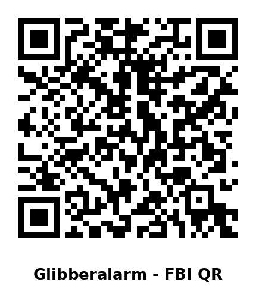
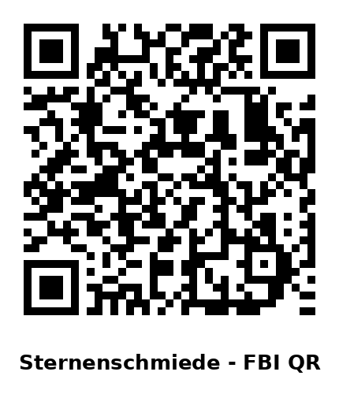

# 3DS Sammlung

Eigene Homebrew-Spiele für den Nintendo 3DS. Jedes Spiel wird automatisch als `.cia` und `.3dsx` gebaut
und kann per QR-Code mit **FBI** installiert werden.

## Spiele

| Spiel | Genre | Beschreibung |
|---|---|---|
| **Goo Alert** | Tower Defense | 10 Türme mit je 2 Upgrade-Pfaden (4 Stufen), Glibber die in kleinere zerplatzen, Geister/Panzer/Nachwachsen, Bosse, 4 Karten, 3 Schwierigkeitsgrade, Endlosmodus. Drag & Drop per Touch. |
| **Star Forge** (v2) | Idle + Weltraum-Action | Expeditionen mit eigenem Bergbau-Schiff durch 12 Sektoren (Erz, Minen, Drohnen, Sprungtore), 10 Schiffs-Upgrades, Aufträge, 20 Artefakte. Dazu 14 Gebäude, 220+ Upgrades, Supernova- und Big-Bang-Prestige, 157 Erfolge. |

## Installation

1. Website der Sammlung öffnen (GitHub Pages, Ordner `docs/`).
2. Auf dem 3DS: **FBI → Remote Install → Scan QR Code**, den Code des Spiels scannen.

Direkt-QR-Codes:

| Goo Alert | Star Forge |
|---|---|
|  |  |

Alternativ die `.cia` aus den [Releases](../../releases) auf die SD-Karte kopieren und mit FBI installieren,
oder die `.3dsx` nach `sd:/3ds/` legen und über den Homebrew Launcher starten.

## Selbst bauen

Benötigt nur Docker:

```bash
./build.sh                 # alle Spiele
./build.sh sternenschmiede # nur eins
```

Ergebnis liegt in `dist/`. Bei jedem Push auf `main` baut GitHub alles neu und aktualisiert das Release `sammlung`.

## Neues Spiel hinzufügen

1. Ordner `games/<name>/` mit `source/`, `meta/icon.png` (48×48), `meta/banner.png` (256×128),
   `meta/banner.wav`, `Makefile` und `game.cfg` anlegen (am besten `sternenschmiede` kopieren).
2. In `game.cfg` eine eigene `UNIQUE_ID` und einen eigenen `PRODUCT_CODE` vergeben.
3. Das Spiel in `docs/games.json` eintragen und Bilder nach `docs/img/` kopieren.

## Entwicklung

Jedes Spiel trennt Logik und Grafik, z. B. bei Goo Alert (`games/glibberalarm`):

- `source/td.c`: Türme, Glibber, Wellen, Karten (ohne 3DS-Abhängigkeiten)
- `source/main.c`: Grafik, Touch, Sound, Speichern
- `test/sim.c`: Bot spielt alle Karten und Schwierigkeitsgrade (Balance-Check)
- `test/shots.sh`: Screenshots am PC

Star Forge (`games/sternenschmiede`):

- `source/expedition.c`: Action-Modus (Schiff, Asteroiden, Drohnen)

- `source/game.c`: Spiellogik ohne 3DS-Abhängigkeiten
- `source/main.c`: Grafik, Touch, Sound, Speichern (citro2d)
- `test/sim.c`: Balancing-Simulation (`gcc test/sim.c source/game.c -lm && ./a.out 12`)
- `test/shots.sh`: Screenshots am PC über einen Software-Renderer
